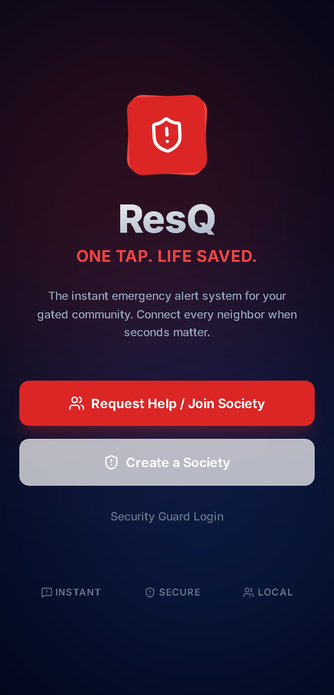
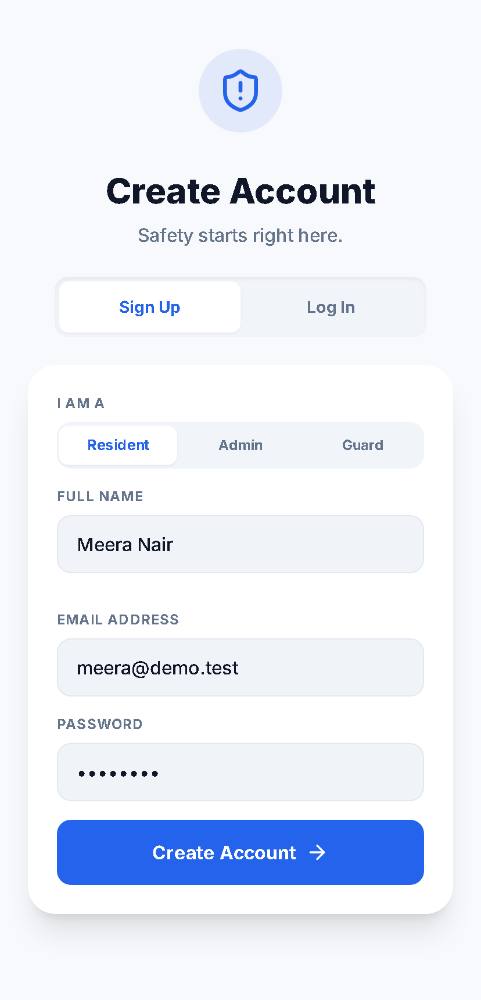
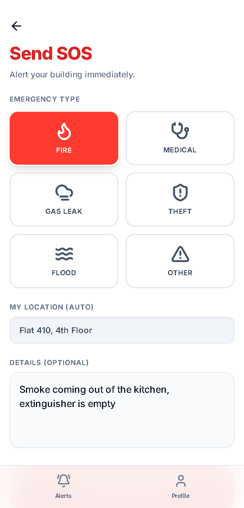
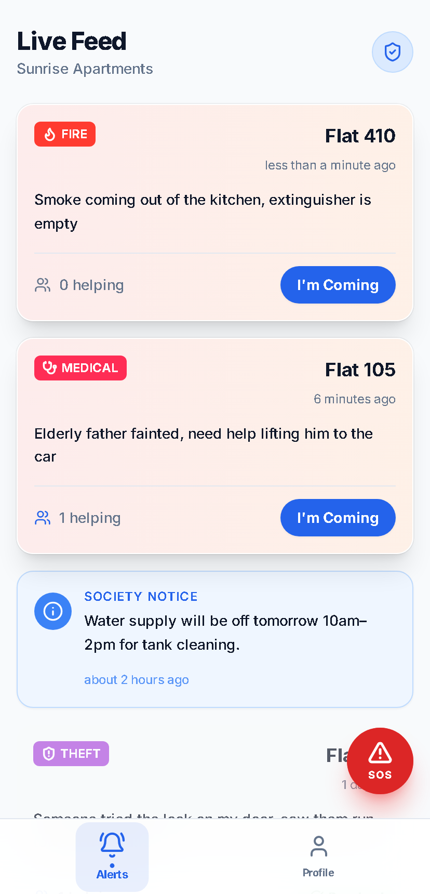
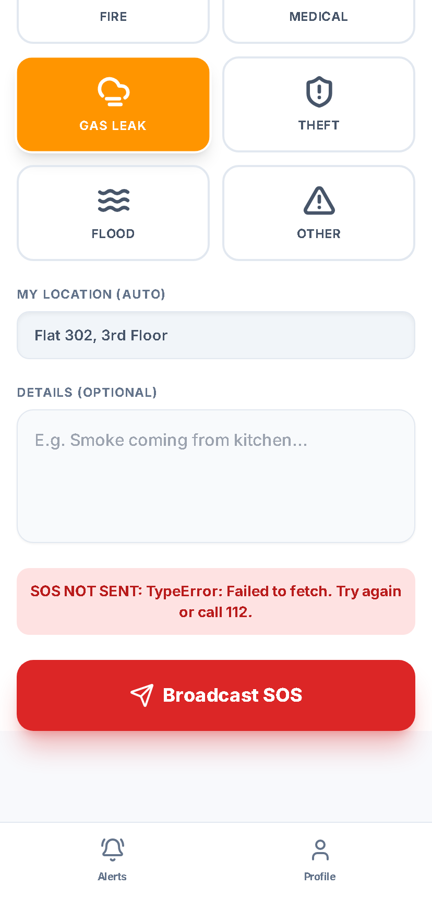
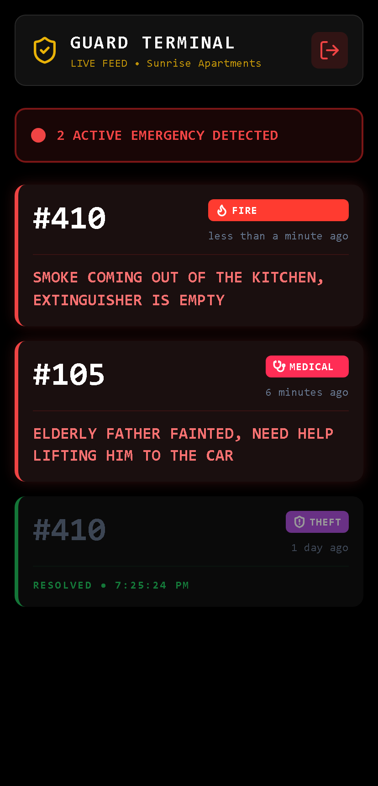
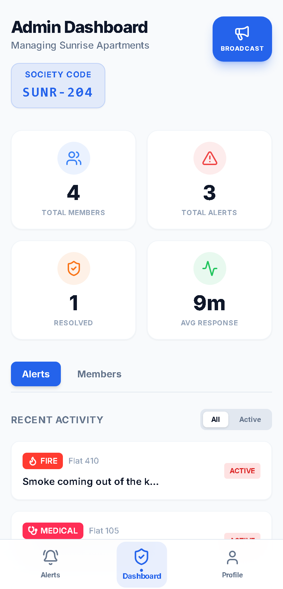
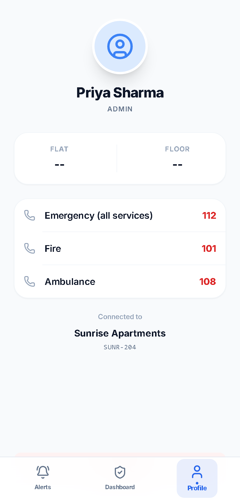
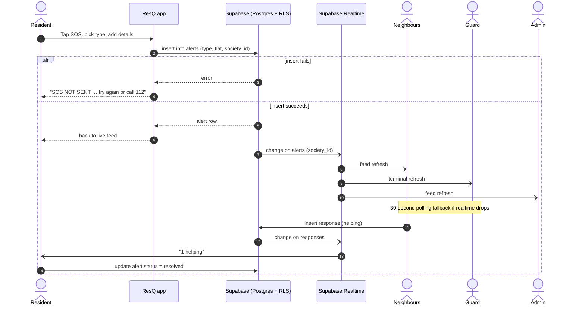

<p align="center"></p>

<p align="center">
  
  
  
  
  
</p>

<p align="center">
  
</p>

---

## What it is

**ResQ** is a mobile-first emergency alert app for gated communities and apartment societies. When something goes wrong (a fire, a medical emergency, a gas leak, a break-in), a resident taps **SOS**. Every neighbour and the security guard on duty sees it in a live feed within seconds, along with the flat number and what's happening. Neighbours tap **I'm Coming** so everyone can see that help is on the way. The society admin gets a dashboard with members, alert history and average response time.

It runs on Supabase (auth, Postgres with row-level security, realtime). There's no separate backend to run.

## Features

| | Who | What they get |
|---|---|---|
| 🆘 | **Residents** | One-tap SOS with 6 emergency types (fire, medical, gas leak, theft, flood, other), auto-filled flat/floor, optional details. Mark their own alert resolved. |
| 🤝 | **Neighbours** | Live feed of alerts and society notices. **I'm Coming** button with a running "N helping" count, and the button changes to *You're coming* after you tap it. |
| 🛡️ | **Guards** | A high-contrast dark **Guard Terminal**: big flat numbers, an "N ACTIVE EMERGENCY" banner, and a clear *FEED OFFLINE* warning if the connection drops. |
| 🏢 | **Admins** | Create a society and get an invite code. The dashboard shows total members, alerts, resolved count and average response time, plus an alert filter, a members directory, broadcast notices, and the ability to resolve any alert. |
| 📞 | **Everyone** | Tap-to-call emergency numbers (112 / 101 / 108) on the profile screen. |
| ⚡ | **Reliability** | Realtime updates via Supabase channels, with a 30-second polling fallback. Failures are always visible: a failed SOS says **SOS NOT SENT**, and a failed feed load shows an error with Retry instead of an empty "all clear". |

## Screenshots

<table>
  <tr>
    <td align="center"><br><sub>Landing</sub></td>
    <td align="center"><br><sub>Sign up (role preselected)</sub></td>
    <td align="center"><br><sub>Send SOS</sub></td>
    <td align="center"><br><sub>Neighbour's live feed</sub></td>
  </tr>
  <tr>
    <td align="center"><br><sub>Failed SOS fails loudly</sub></td>
    <td align="center"><br><sub>Guard terminal</sub></td>
    <td align="center"><br><sub>Admin dashboard</sub></td>
    <td align="center"><br><sub>Profile + emergency numbers</sub></td>
  </tr>
</table>

<sub>Screenshots use demo data only.</sub>

## How an SOS flows



## Quickstart

```bash
git clone https://github.com/ekupekuAI/ResQ.git
cd ResQ
npm install
cp .env.example .env   # then fill in the two values below
npm run dev
```

1. Create a free project at [supabase.com](https://supabase.com/dashboard).
2. Open **SQL Editor**, paste [`supabase/schema.sql`](supabase/schema.sql) and run it. It creates the tables, row-level-security policies and the realtime publication.
3. Fill in `.env` and start the dev server. If either variable is missing, the app shows a *"ResQ is not configured"* screen instead of failing silently.

Production build: `npm run build` (output in `dist/`). `vercel.json` already rewrites all routes to `index.html` for SPA routing.

### Environment variables

| Name | Required | Where to get it |
|---|---|---|
| `VITE_SUPABASE_URL` | ✅ Yes | Supabase dashboard → **Project Settings → API** → *Project URL* |
| `VITE_SUPABASE_ANON_KEY` | ✅ Yes | Supabase dashboard → **Project Settings → API** → *anon / public* key |

> [!NOTE]
> Admin sign-up is currently restricted in code to the project owner's email (`src/context/AuthContext.jsx`). Change that check if other people should be able to create societies.

<details>
<summary><b>Project structure</b></summary>

```text
ResQ/
├── supabase/
│   └── schema.sql            # tables, RLS policies, realtime publication
├── src/
│   ├── App.jsx               # routes, role-based guards, "not configured" screen
│   ├── context/
│   │   └── AuthContext.jsx   # Supabase auth session + profile sync
│   ├── lib/
│   │   ├── supabase.js       # client (reads VITE_SUPABASE_* env vars)
│   │   └── utils.js          # emergency types, colours, icons
│   ├── services/
│   │   ├── alerts.js         # feed, SOS, responses, announcements, realtime
│   │   └── societies.js      # create / join society, members
│   ├── components/           # AlertCard, AnnouncementCard, SOSButton, Navbar, EmergencyBadge
│   └── pages/
│       ├── LandingPage.jsx   AuthPage.jsx      JoinSociety.jsx   CreateSociety.jsx
│       ├── Home.jsx          SendAlert.jsx     GuardView.jsx     AdminDashboard.jsx
│       └── Announcements.jsx Profile.jsx       SafetyCheck.jsx
├── docs/readme/              # banner + screenshots for this README
├── .env.example
└── vercel.json               # SPA rewrite
```

</details>

## What's new in this version

| Area | Before | After |
|---|---|---|
| Sending an SOS | If the insert failed, the button stayed on *"Sending Alert..."* forever and nobody was told | Shows **SOS NOT SENT** with the reason and "try again or call 112". A missing flat number never blocks an SOS. |
| Live updates | Realtime listener was never started and tables weren't in the realtime publication, so the feed only changed on reload | Per-society realtime channel, `supabase_realtime` publication in the schema, plus a 30-second polling fallback |
| Feed errors | A failed load showed *"No active alerts"*, which looks like all-clear | Visible error with **Retry**. The guard terminal shows **FEED OFFLINE**. |
| Guard terminal | Crashed on any alert without a description and showed the society's internal UUID | Handles empty descriptions and shows the society name |
| I'm Coming / Resolve | Errors were swallowed and the feed didn't refresh after tapping | Errors are shown, the feed refreshes, and the button changes to *You're coming* |
| SOS button | Shown to admins, but the route bounced them away | Shown to residents only |
| Sign-up | Landing-page role (`?role=`) ignored. Sign-ups with email confirmation failed on RLS. A missing profile row silently logged users out. | Role preselected, *"check your email"* message, profile auto-created on first login, clear error if the profile is missing |
| Missing config | App crashed on first auth call | *"ResQ is not configured"* setup screen |
| Profile | Three menu buttons that did nothing | Working tap-to-call emergency numbers |
| Alert times | Clock time only (yesterday's alert looked like today's) | Relative time ("5 minutes ago") |
| Build | `npm ci` failed (lockfile out of sync), Inter font never loaded, obsolete `scaffold.js` could overwrite every page | Clean install, font loads, script removed, `.env.example` added |

## Future development

- **Push / SMS notifications.** Alerts currently reach people who have the app open. Web Push or an SMS provider would wake phones.
- **Harden RLS.** Society codes are readable by anyone, and users can edit their own `role`. Move joining to a `SECURITY DEFINER` function and lock the `role` column.
- **Evacuation check-in.** `SafetyCheck.jsx` exists but isn't linked anywhere yet. Wire it to the `responses.type = 'safe'` value already in the schema.
- **Guard acknowledgement.** Let guards mark "responding" from the terminal.
- **Editable profile.** Update name, phone, flat and floor after onboarding.
- **Smaller bundle.** Icons are imported as `* as Icons`, so the JS bundle is about 640 KB. Import only the icons that are used.
- **Configurable admins.** Replace the hard-coded owner email with an allow-list.
